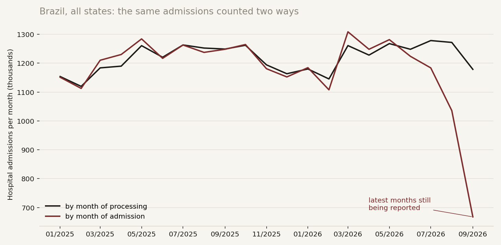
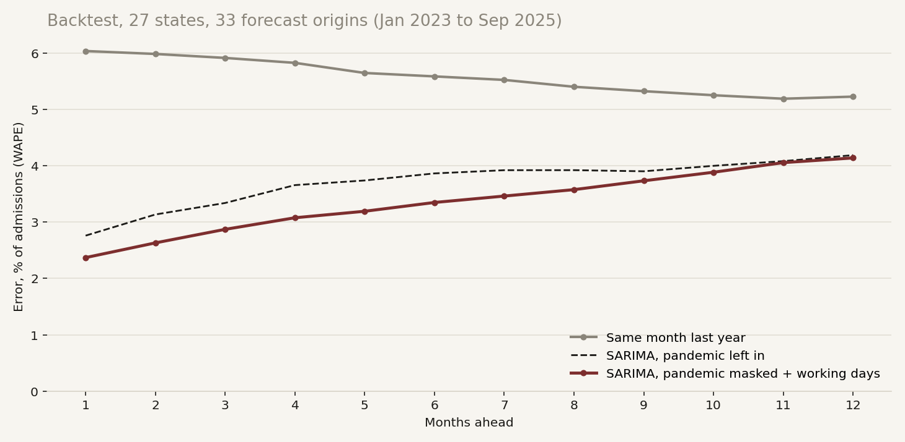
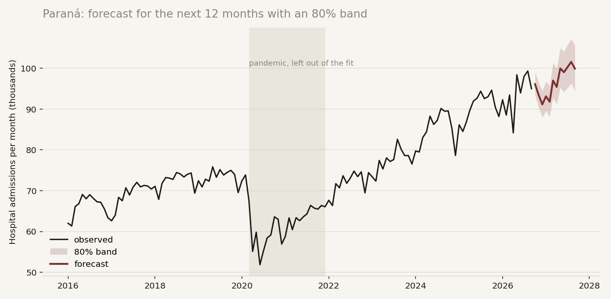

# hospital-admissions-forecast

[](https://github.com/rhozon/hospital-admissions-forecast/actions/workflows/ci.yml)

Twelve-month forecasts of SUS hospital admissions for each of Brazil's 27 states, built
from public DATASUS data and tested the way a planning team would use them: a
**rolling-origin backtest** against the **seasonal naive** benchmark (same month last
year), with **80% bands checked for coverage**, not just drawn.

Case study page: <https://rhozon.github.io/portfolio/hospital-admissions.html>

## Quickstart

```bash
pip install -e ".[dev]"
pytest -v                                    # unit tests, no network needed
python -m admissions.cli backtest            # 27 states x 33 origins x 4 models, a few minutes
python -m admissions.cli forecast            # next 12 months for every state
python -m admissions.cli figures             # charts, in English and Portuguese
python -m admissions.cli fetch               # optional: refresh data/ from DATASUS TabNet
```

The data in `data/` is a snapshot of TabNet taken on the date in `data/FETCHED`, so the
backtest reproduces without network access. `fetch` downloads the current version.

## Data

`SIH/SUS`, approved hospital admissions (AIH) by state and month, from the TabNet query
`sih/cnv/niuf.def`, January 2008 onwards. Two versions of the same counts are saved:

- `admissions_by_processing_month.csv`: when the admission was processed for payment.
- `admissions_by_service_month.csv`: when the patient was admitted.

The second is the natural choice and the wrong one for the latest months. Hospitals
submit admissions with a delay, so the most recent service months are still filling
up: in the snapshot the last three months are 7%, 19% and 43% below their processing
month counterparts. A model fitted on them reads the delay as a collapse in demand.
The forecast uses the processing month, which has no such trailing shortfall. It
does have the occasional batch that never arrived, handled by the first cleaning rule
below.



## Method

**Cleaning, two rules, both in `admissions/clean.py`.**

- *Reporting gaps.* A month below 60% of the median of the previous 12 is treated as a
  batch that was not sent, and set to missing. The rule looks only backwards, so it can
  run on the latest month. In the snapshot it flags 9 months in 3 states, among them
  Acre at zero in August and September 2026.
- *The pandemic.* March 2020 to December 2021 is set to missing for fitting. Elective
  care stopped and then caught up; those months describe a shock, not the seasonal
  pattern a forecast has to reproduce.

**Model.** Seasonal ARIMA (0,1,1)(0,1,1)12 on log admissions, the "airline" model, with
the number of working days in the month as a regressor (national holidays plus
Carnival, `admissions/workdays.py`). Elective admissions happen on working days, and the
calendar is known in advance, so it is a fair input. Missing months are skipped by the
Kalman filter instead of being imputed.

**Backtest.** At each origin from January 2023 to September 2025 (33 origins) the model
is refitted on the data up to that month and forecasts the next 12. Four variants are
compared, so each decision has its own evidence:

| Variant | Pandemic months | Working days |
|---|---|---|
| `seasonal_naive` | n/a | n/a |
| `sarima_raw` | used as data | no |
| `sarima_masked` | missing | no |
| `sarima_masked_wd` (final) | missing | yes |

Error is **WAPE**: total absolute error over total admissions. It reads as "off by X% of
the volume" and does not blow up on small states the way an average of monthly
percentage errors does. Months flagged as reporting gaps are not scored.

## Results

27 states, 33 origins, 12 months ahead. Full tables in `results/summary.md`.

WAPE, % of admissions:

| Model | 1-3 months | 4-6 months | 7-12 months |
|---|---|---|---|
| Seasonal naive | 5.98 | 5.69 | 5.32 |
| SARIMA, pandemic left in | 3.08 | 3.75 | 4.00 |
| SARIMA, pandemic masked | 2.82 | 3.35 | 3.92 |
| **SARIMA, pandemic masked + working days** | **2.62** | **3.21** | **3.81** |



- The final model has a lower WAPE than the seasonal naive in **27 of 27 states**.
- **12-month total**, the figure a budget is built on (877 state-origin pairs with
  complete data): median absolute error **2.7%** against **4.5%** for the naive,
  90th percentile **7.0%** against **9.1%**.
- **80% bands.** With the pandemic left in the data, the band is wide enough to hold
  the actual value 87% to 96% of the time, at a median width of 15% to 27% of the
  forecast. Masking the pandemic brings coverage to **80% to 83%** and the width to
  **10% to 16%**. The point forecast barely moves; the band is what changes.
- Small states are hard for every model: Roraima and Amapá stay above 16% WAPE.

`results/forecast.csv` has the forecast for October 2026 to September 2027 for every
state, with the 80% band.



## Design decisions

- **Processing month, not service month.** See Data. This is the single choice that
  matters most, and the easiest to get wrong.
- **One simple model, refitted every month,** instead of model selection per state. A
  structural time series model (local linear trend plus seasonal) was tried during
  development and did no better, so the simpler one stayed.
- **WAPE instead of MAPE.** Roraima and Amapá have a few thousand admissions a month;
  an average of percentage errors lets them dominate the score.
- **Intervals are judged by coverage.** A band labelled 80% should contain the actual
  value about 80% of the time. Too narrow and the plan is overconfident; too wide and
  it carries spare beds and staff it does not need.
- **No exogenous data beyond the calendar.** Epidemics, policy changes and new hospitals
  move admissions, but their future values are not known when the forecast is made.

## Limitations

- State totals only. Planning a hospital or a specialty needs the same pipeline on the
  matching cut (CID-10 chapter, municipality, facility), which TabNet also offers.
- Processing month is a proxy for demand: it includes admissions from earlier months
  that were submitted late.
- The pandemic window is fixed by hand. A shock of that size in the future would need
  the same decision again, and the backtest cannot tell how well it would go.

## Layout

```
admissions/   TabNet client, cleaning rules, calendar, models, backtest, metrics, charts, CLI
data/         TabNet snapshot (processing month and service month), fetch date
results/      backtest.csv.gz, summary.md and summary.json, forecast.csv, figures/
tests/        unit tests, including a parser fixture with real TabNet output
.github/      CI: tests and a backtest smoke run
```

MIT License.
